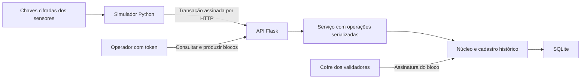

# Etapa 3: API Python e simulador de sensores IoT

Status: concluída. **95 testes aprovados**: 62 das etapas anteriores,
22 da API e 11 de integração com servidor Waitress e sockets reais.

## Arquitetura implementada



O serviço abre uma instância de `Sistema` dentro da thread que realiza a
operação e fecha sua conexão SQLite ao concluir. Um `RLock` serializa o acesso
à fila e à produção dos blocos. Não há conexão SQLite criada em uma thread
e reutilizada indevidamente por outra. O estado persistente é recarregado em
cada operação; as pendências permanecem na memória do serviço.

A criação da aplicação usa uma factory Flask, permitindo configurações
isoladas nos testes, conforme o [padrão documentado pelo Flask](https://flask.palletsprojects.com/en/stable/patterns/appfactories/).
O comando `iniciar_api.py` usa Waitress como servidor WSGI, sem depurador e
sem recarregamento automático. A distinção entre o servidor de desenvolvimento
e um servidor WSGI está na [documentação de implantação do Flask](https://flask.palletsprojects.com/en/stable/deploying/).

## Preparação e execução

Na pasta do projeto, instale as dependências do README. Em um terminal:

```powershell
.\.venv\Scripts\python.exe preparar_demo_api.py .\dados-api
.\.venv\Scripts\python.exe iniciar_api.py .\dados-api
```

O primeiro comando solicita uma senha, cria V1/V2/V3, cadastra dois sensores
e prepara um pacote de simulação. Pastas existentes são recusadas. A pasta
só é publicada depois de concluir o banco, as chaves e o manifesto dos sensores.

O segundo solicita a senha dos validadores e um token administrativo de 32 a
256 caracteres ASCII sem espaços. O token não é gravado e não é exibido.
A API utiliza seu hash para a comparação de autenticação. O serviço conserva
a senha dos validadores em memória durante a sessão, para desbloquear as
chaves quando um bloco é solicitado. Não há endpoint para receber senhas.

A API escuta em `http://127.0.0.1:5000`. Para outra porta, use `--porta 5001`
e passe `--url http://127.0.0.1:5001` aos clientes. O modo implementado é
local, em um único processo; não configura acesso remoto, TLS ou uma rede
de validadores independentes.

Em outro terminal:

```powershell
.\.venv\Scripts\python.exe simulador_iot.py .\dados-api\simulador --amostras 5 --intervalo 1 --confirmar
```

Informe a senha dos sensores e o mesmo token da sessão da API. Cada ciclo
envia uma leitura de temperatura e uma de umidade. Com `--confirmar`, um
bloco é solicitado depois de cada ciclo. Cinco ciclos produzem dez leituras,
cinco blocos regulares e o gênese inicial.

Sem `--confirmar`, o simulador apenas envia leituras para a fila e não solicita
token administrativo. A produção pode ser feita por:

```powershell
.\.venv\Scripts\python.exe cliente_api.py produzir
.\.venv\Scripts\python.exe cliente_api.py estado
.\.venv\Scripts\python.exe cliente_api.py historico --dispositivo sensor-temp-01
.\.venv\Scripts\python.exe cliente_api.py validar
```

O cliente administrativo solicita o token por entrada oculta. Ele também
aceita `cadeia`, `membros` e `pendentes`. Todos os argumentos de terminal
são públicos; senhas e tokens não são recebidos como argumentos.

## Identidade do simulador e leituras

O pacote `simulador/` contém `sensores.json`, com configuração pública, e
arquivos cifrados somente das chaves dos sensores. O simulador não precisa
abrir o SQLite, carregar chaves de validadores ou transmitir chaves privadas.
A preparação da demonstração gera as identidades de forma centralizada e
local; ao integrar sensores reais, o servidor deverá receber somente suas
chaves públicas, mantendo as privadas sob responsabilidade dos emissores.

O manifesto fixa a rede esperada. Antes de enviar, o simulador compara essa
identificação com `GET /rede`. Rede divergente, manifesto inválido ou senha
incorreta impedem o envio. O cliente HTTP aceita somente endereços locais,
não utiliza proxies nem segue redirecionamentos, e não repete automaticamente
operações cujo resultado possa ter sido confirmado antes de uma falha de conexão.

As faixas padrão são 20 a 30 °C para temperatura e 40 a 70 % para umidade
relativa. São valores sintéticos, não medições físicas. `--semente 7` repete
a sequência dos valores; timestamps e identificadores continuam novos.
`--amostras` aceita 1 a 1000 ciclos; `--intervalo` aceita 0 a 3600 segundos.
Uma simulação longa ou muito rápida pode atingir os limites de ingresso.
O simulador ainda não é o benchmark da etapa 5.

Novas leituras com metadados usam transação **versão 3**. O conteúdo assinado
inclui versão, identificador único, rede, dispositivo, valor, timestamp e
`medicao`, que contém `grandeza` e `unidade`. Alterar a unidade invalida a
assinatura. Os blocos continuam no formato 2 e podem conter transações 2 e 3.
Os dados válidos da etapa 2 preservam a representação assinada e continuam
carregáveis; não foi introduzida migração automática de bancos da etapa 1.

## Contrato HTTP

Base: `http://127.0.0.1:5000`. Corpos de escrita são objetos JSON com
`Content-Type: application/json`. Consultas privadas e administração exigem
`Authorization: Bearer <token>`. Credenciais em parâmetros de URL são recusadas.

| Método e rota | Autorização | Resultado |
|---|---|---|
| `GET /saude` | Pública | Liveness do processo, sem verificar todo o ledger |
| `GET /rede` | Pública | Identificação da rede e formatos de transação aceitos |
| `POST /transacao` | Assinatura do dispositivo no corpo | 202, identificador e situação pendente |
| `GET /estado` | Token | Contagem de blocos, leituras e pendências; próxima autoridade |
| `GET /cadeia` | Token | Blocos paginados |
| `GET /blocos/<indice>` | Token | Um bloco completo |
| `GET /validar` | Token | Validade da cadeia carregada e quantidade de blocos |
| `GET /historico/<nome>` | Token | Leituras assinadas do dispositivo, com bloco de origem |
| `GET /pendentes` | Token | Fila paginada |
| `GET /transacoes/<id>` | Token | Situação pendente ou confirmada, com registro correspondente |
| `POST /blocos` | Token | 201; produz um bloco contendo a fila validada |
| `DELETE /pendentes/<id>` | Token | Remove uma pendência explicitamente |
| `GET /membros` | Token | Cadastro público de membros paginado, sem chaves privadas |
| `POST /membros` | Token | 201; cadastra um novo dispositivo por chave pública |
| `PUT /membros/<nome>` | Token | Rotaciona a chave pública de um dispositivo e o ativa |
| `POST /membros/<nome>/revogar` | Token | Revoga operações futuras e preserva o histórico |

`POST /blocos` e a revogação recebem `{}`. O cadastro recebe exatamente
`{"nome": "sensor-novo", "pub_hex": "<chave pública Ed25519 hexadecimal>"}`.
A rotação recebe exatamente `{"pub_hex": "<nova chave pública>"}`.
O cadastro não sobrescreve nomes existentes e não recebe chaves privadas.
A API de rotação é restrita a dispositivos; alterações na ordem das autoridades
continuam fora do escopo. Revogar a última autoridade ativa é recusado.

O payload de uma leitura é obtido por `Transacao.criar(...).to_dict()`.
Ele deve ser assinado antes de ser enviado; enviar apenas nome e valor não
é suficiente. A API não assina uma leitura em nome de um dispositivo remoto.

As listas aceitam `?inicio=0&limite=50`; limite entre 1 e 100. A resposta
possui `total`, `inicio`, `limite` e `itens`. Parâmetros desconhecidos,
repetidos ou fora dos limites são recusados.

Erros usam o formato:

```json
{"erro": {"codigo": "replay", "mensagem": "transação repetida (replay)"}}
```

| Status | Significado |
|---|---|
| 400 | JSON/schema, texto, paginação, nome ou chave pública inválidos |
| 401 | Token administrativo ausente ou incorreto |
| 404 | Recurso ou rota não encontrados, após autenticação quando aplicável |
| 409 | Replay, fila vazia ou tentativa de reutilizar um nome cadastrado |
| 413 | Corpo maior que 64 KiB |
| 415 | Tipo de conteúdo incompatível |
| 422 | Assinatura, autorização, medição ou operação de negócio inválida |
| 429 | Fila cheia ou limite de requisições atingido |
| 503 | Estado persistido indisponível, corrompido ou impossível de atualizar |

Se o banco não puder ser carregado validamente, `/validar` retorna 503 com
erro de estado; não informa falsamente uma cadeia válida nem recria o banco.

## Limites e operação

- Corpo máximo de 64 KiB por requisição e valor textual de até 4096 bytes UTF-8.
- Fila padrão de 1000 pendências; produção sempre exige operação administrativa.
- Limite padrão de 300 requisições por minuto por IP, compartilhado entre rotas.
  `X-Forwarded-For` não altera o endereço considerado. Limite de requisições
  retorna `Retry-After: 60`; fila cheia exige confirmar ou descartar pendências.
- Sem CORS aberto; respostas não devem ser armazenadas em cache.
- Consultas operacionais também exigem token, pois o ledger pode conter dados sensíveis.
- Um processo com múltiplas threads. Não iniciar múltiplos workers sobre a mesma
  fila nem usar este serviço como protocolo de consenso distribuído.
- As pendências continuam voláteis. Confirmação é indicada pelo bloco persistido,
  e não pelo 202 recebido no ingresso. O reinício perde mensagens não confirmadas.
- Falhas de conexão não causam repetição automática. Consulte `/transacoes/<id>`
  com autorização administrativa antes de decidir reenviar a mesma transação.
- Uma pendência de sensor revogado bloqueia a produção até seu descarte explícito.
- As assinaturas não validam a veracidade física das leituras nem resolvem o oráculo.

## Evidência e próximos passos

A suíte foi executada no Windows AMD64 com Python 3.12.14, SQLite 3.53.1,
cryptography 50.0.2, Flask 3.1.3, Waitress 3.0.2 e Werkzeug 3.1.9.
Os 95 testes passaram. Entre os casos novos estão adulteração de unidade,
compatibilidade entre transações 2 e 3, chamadas concorrentes, replay simultâneo,
limites de corpo/fila/volume, cadastro público, rotação, revogação, banco
adulterado e sensor em outro processo enviando por HTTP real ao Waitress.

Os testes HTTP precisaram de execução fora do bloqueio de sockets do ambiente
isolado do agente. Utilizaram apenas 127.0.0.1, portas temporárias e pastas
temporárias; os servidores foram encerrados após cada cenário. Isso é uma
verificação funcional; não houve benchmark de throughput ou latência.

No TCC, atualizar a Figura 2, o fluxo da seção 5.6 e as limitações das seções
5.1, 5.7 e 5.8 para refletir a API e a simulação HTTP. A seção 5.2 precisa
descrever a transação 3 e os metadados assinados. A seção 6 deve separar a
evidência anterior dos 95 testes atuais e continuar distinguindo sensores
simulados de físicos e HTTP local de uma rede blockchain distribuída.
O PDF não foi editado nesta etapa.

A etapa 4 será o painel visual apoiado nesses endpoints. A etapa 5 reunirá
os experimentos, o roteiro final da apresentação e a atualização do manuscrito.
